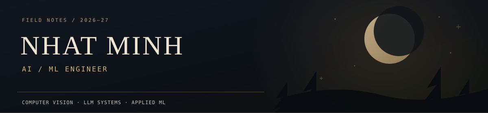
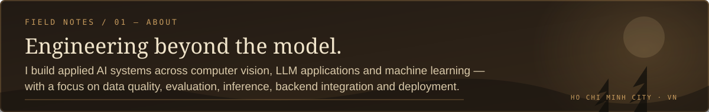
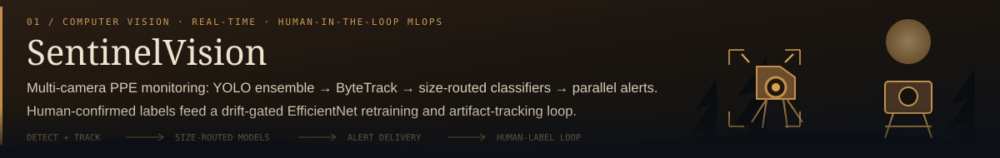
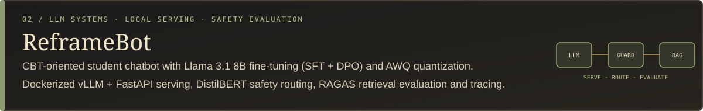
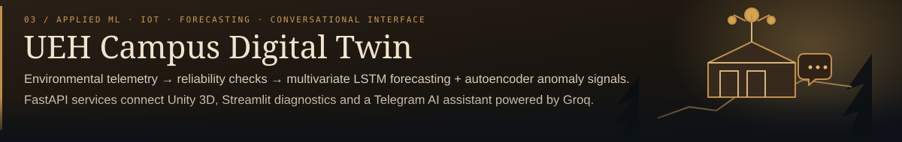
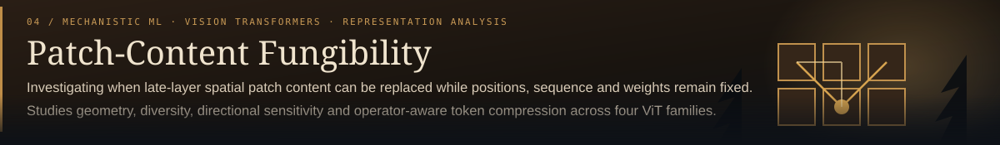
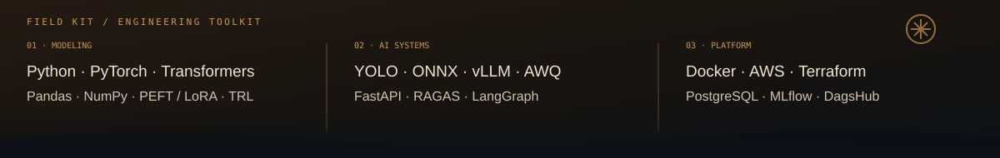
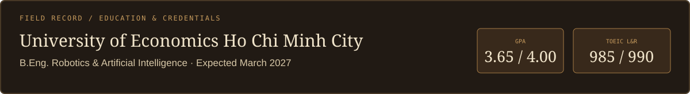

  

  <a href="https://www.linkedin.com/in/nnminh115/">LinkedIn</a>
  &nbsp;·&nbsp;
  <a href="mailto:nhatminhvcst115@gmail.com">Email</a>
  &nbsp;·&nbsp;
  <a href="https://github.com/nhatminh-115">GitHub</a>

  <strong>Ho Chi Minh City, Vietnam</strong> &nbsp;·&nbsp; Robotics &amp; Artificial Intelligence, UEH &nbsp;·&nbsp; Class of 2027

  

  
Technical notes — SentinelVision

  - **Detection and tracking:** YOLO ensemble, Weighted Boxes Fusion, ByteTrack, and temporal smoothing for multi-person tracking.
  - **Dual-path classification:** EfficientNetV2-B0 ONNX for small person boxes; SigLIP SO400M ONNX FP16 for larger boxes.
  - **Inference optimization:** EfficientNet ONNX reaches **7.46 ms CPU latency** with **F1 = 0.92** on the small-box route; SigLIP ONNX FP16 delivers **3.2× GPU speedup** over its PyTorch FP32 baseline.
  - **Human-in-the-loop MLOps:** versioned human-confirmed labels, disagreement monitoring, gated EC2 Spot retraining, and MLflow/DagsHub artifact tracking.

  
Technical notes — ReframeBot

  - Fine-tuned Llama 3.1 8B with **SFT + DPO**, then applied **AWQ 4-bit quantization**.
  - Served through a Dockerized **vLLM + FastAPI** stack with PagedAttention, continuous batching, and SSE streaming.
  - Added a DistilBERT guardrail router for CBT, crisis, and out-of-scope inputs, with explicit crisis-signal handling.
  - Evaluated retrieval quality with **RAGAS** and traced application behavior with LangSmith.

  
Technical notes — UEH Campus Digital Twin

  - Built sensor ingestion, normalization, and a deterministic **data-quality gate** for flatlines, outliers, and missing values.
  - Developed multivariate **LSTM forecasting**, rolling error diagnostics, and Monte Carlo Dropout uncertainty estimates.
  - Integrated an **autoencoder anomaly detector** with feature-level attribution.
  - Connected the models to **FastAPI**, a Unity 3D client, Streamlit monitoring, and a Telegram assistant powered by Groq Llama 3.3 70B.

  
Technical notes — Patch-Content Fungibility

  - Studies patch-content replaceability under fixed token positions, sequence length, and model weights.
  - Examines feature geometry, token diversity, directional sensitivity, and functional transmission across four pretrained ViT families.
  - Includes an operator-aware token-compression benchmark as a bounded application of the mechanistic findings.

  

  

  
Additional credentials

  - Deep Learning Specialization — DeepLearning.AI
  - MLOps Specialization — Duke University
  - NLP &amp; LLMs — UEH

  Interested in AI engineering roles across computer vision, LLM systems, and applied ML.

